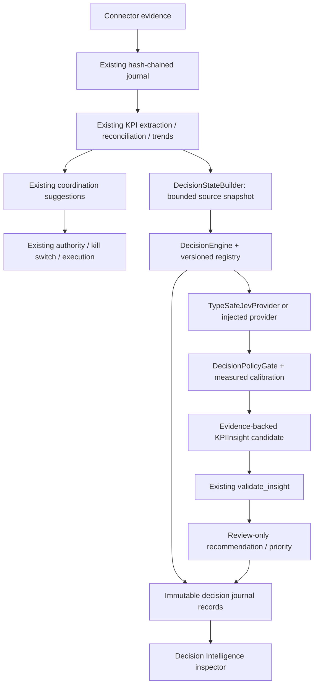

# Bounded decision intelligence

Jev judges. TPLLM decides whether a judgment may influence review. Existing TPLLM
policy and authority remain the only execution controls. The integration is off
by default and has no action-producing output.

## Repository map and insertion point

The inspected implementation is Python/Pydantic with Click entry points and a
FastAPI dashboard. The dashboard serves local HTML/CSS/JavaScript, without a
frontend bundler. Existing uncommitted product-flow changes were retained.

| Concern | Existing implementation |
|---|---|
| Backend / product API | `dashboard.py`, `product_api.py`, `product_flow.py`; `main.py` / CLI |
| Frontend | `web/index.html`, `web/app.js`, `web/flow.js`, `web/app.css` |
| Ontology / evidence claims | `ontology/core.py`, `entities.py`, `interfaces.py`, `measurement.py`, `mapper.py` |
| Evidence inference | `intelligence/project_understanding.py`; provenance in `core/evidence.py` |
| Observations / reconciliation / trends | `intelligence/kpi.py`, `kpi_extraction.py`, `kpi_reconciliation.py`, `kpi_stewardship.py`; `workflows/trend_analyzer.py` |
| Insight gate | `ontology/validation.py::validate_insight`; structural candidates in `structural/signals.py` |
| Recommendations | `coordination/recommendations.py`, `recommendation_validation.py`, `scenario_decisions.py`; `ontology/entities.py::AgentRecommendation` |
| Authority / execution | `product_authority.py::eligible/execute_prepared`, `coordination/authority_policy.py`, `autonomous_decisions.py`, `runtime/validity.py` |
| Kill switches | Product `coordination_paused`; runtime `AutonomyRuntimeState`; `application/control.py` |
| Calibration / auto-revert | `application/registry.py`, `control.py`, `ledger.py`, `monitor.py::auto_revert_if_regressing`; `evaluation/forecast_metrics.py` |
| Action history | Product attempt/receipt transitions; organizational decision/outcome events in `runtime/durability.py` |
| Hash chain / storage | `persistence/journal.py`, `integrity.py`, `sqlite.py`, `snapshots.py`, `versioning.py` |
| Temporal truth | `temporal/models.py::TemporalFactWindow`, `state.py`, `queries.py`, `lineage.py`; `runtime/sources.py::JournalBackedDataSource` |
| Scenario lattice | `scenarios/lattice.py`, `generation.py`, `simulation.py`; runtime service composition |
| Connectors | `product_sources.py`, `integrations/envelopes.py`, provider normalizers/readers and runtime ingestion |
| Generative models | `agent.py::TPMAgent`, Anthropic / OpenAI-compatible configurations in `config.py` |
| Logging / secrets | Standard logging and `observability/`; envelope redaction; journal secret rejection; environment config |
| Existing validation tests | `test_ontology_validation.py`, recommendation/scenario tests, `test_runtime_autonomy_races.py`, product coordination/API, journal/replay and calibration suites |

The product's existing coordination suggestions are deterministic. Its KPI flow
previously did not call the ontology insight validator. This integration adds
review-only insight candidates at that seam, rather than claiming that every
runtime artifact already invokes the full recommendation engine.



There is no edge from R, P or G to X. Off means no inference or decision writes.
Shadow persists diagnostics without changing the existing coordination projection,
KPI math, suggestions, action payloads, grants or receipts. Advisory can prioritize
review in the new insight surface when the exact calibration segment is approved.
It never changes a validator result, insight confidence, committed target, action
payload, permission or execution setting. Existing generative models retain prose,
summaries, planning and tool workflows; this subsystem requests no prose.

## Files added or extended

All paths below are relative to `src/tpllm/` except where specified.

| File | Purpose |
|---|---|
| `decisions/models.py` | Neutral typed questions, results, states, evaluations, traces, labels and calibration profiles |
| `decisions/registry.py` | Ten trusted versioned definitions; defensive copies and duplicate prevention |
| `decisions/state.py` | Explicit allowlist, bounded source selection, source redaction, temporal cutoff, canonical hash |
| `decisions/config.py` | Server-only environment flags and redacted API key |
| `decisions/providers.py` | Provider protocol, TypeSafe wire adapter, explicit mock; response validation and bounded retry |
| `decisions/policy.py` | Conservative configurable acceptance, exact calibration segments and uncertainty |
| `decisions/engine.py` | Shared-state batching, caching with policy revalidation, immutable traces and comparisons |
| `decisions/evaluation.py` | Provider-neutral fixture harness and executed existing KPI baseline |
| `decisions/__init__.py` | Public neutral interfaces |
| `runtime/decision_journal.py` | Journal-backed traces, supersession, outcome labels, downstream effect records |
| `persistence/models.py` | Three additive journal event kinds |
| `runtime/durability.py` | Restore bounded history on replay, without inference or execution |
| `application/decision_calibration.py` | Per-segment quality metrics, telemetry and governed profile consultation |
| `application/registry.py` | `decision_profiles` on the existing ActiveCalibrationRegistry |
| `product_decisions.py` | Product adapter, evidence-ID bridge, unchanged validator, review projection |
| `product_flow.py` | One assessment hook after the existing projection is written |
| `product_api.py` | Decision inspector data, authenticated detail/label endpoints, explicit analysis rerun |
| `web/decisions.js` | Compact expandable insight judgments, distributions, policy, evidence and calibration review |
| `web/app.js`, `index.html`, `app.css` | Small integration into the existing Intelligence view |
| `.env.example` | Disabled defaults and server environment documentation |
| `tests/test_decision_*.py`, `tests/_decision_fixtures.py` | Provider, state, policy, persistence, calibration, product and authority tests |
| `tests/fixtures/decisions/` | Five authored cases and locked v1 definition fingerprints |
| `tests/test_product_api.py` | Authenticated read-route inventory and scoped outcome-label permissions |
| `evals/decisions/run.py`, `demo.py` | Repeatable evaluation and complete synthetic product trace |
| `evals/decisions/results.mock.json`, `demo.mock.json` | Explicitly synthetic example results, not production evidence |

## Official API contract

Verified on 2026-10-30 against the official
[System One API](https://docs.typesafe.ai/api/system-one),
[error rules](https://docs.typesafe.ai/api/errors), and
[OpenAPI schema](https://api.typesafe.ai/openapi.json) (API schema version 0.2.0).
Fetched schema SHA-256:
`3ca93b6e6b9aa8d7820531b78c66ed7a9798b11e6e163ad96b140fb3d75fbcf4`.

The adapter sends bearer authentication to `https://api.typesafe.ai/v1/systemone`.
It sends one structured state and ten independently worded questions per KPI
snapshot. Noul uses `noul`; Choice uses `choice`, `confidence`, `probabilities`;
Score uses `score`, `confidence`, `probabilities`, `legend`. Response `model` and
request model are retained separately. If the response only reports an alias,
it is retained honestly and cannot receive advisory approval as a pinned model.
Model discovery via `/v1/models` is optional and not used automatically.

Only stable text/structured-state primitives are enabled. No assets, Box,
long-context danger-zone headers, arbitrary endpoint overrides, or redirects.
Unknown answer keys invalidate the batch; missing/malformed individual answers
become unavailable while valid independent answers are retained. Numerical ranges,
finite numbers, distribution support/sum, winning choice, expected score, matching
legend and usage counts are checked. Provider exception bodies are never logged.
Transient HTTP/network/timeouts have bounded retries; credentials/schema/model
errors fail immediately. A missing credential cannot trigger inference.

## State and trust boundary

The builder receives project-scoped source versions and evidence IDs, selected
observations, trend values, declared targets, supported relationship endpoints,
and optional prior temporal events. Timestamps are normalized before selection;
future-known or future-valid evidence is excluded. Selection is limited to 40
source records, 80 measurements, 40 supported relationships and 20 prior events;
truncation is explicit. Facts are sorted before hashing.
The product bridge maps the KPI extractor's derived evidence IDs to the actual
journal envelope IDs without modifying either original pipeline or history.

Default source fields are operational status, blocked/merged/deployment state,
selected recovery and dependency counters, and provenance. Raw messages, authors,
email addresses, patches and arbitrary metadata are omitted. Explicitly enabling
source excerpts adds at most 400 redacted characters per selected source. All such
content remains data under trusted registry instructions. It cannot redefine
questions, policy, tools or authority. Redaction is best effort, not a guarantee
against every possible secret format; outbound selection is the primary boundary.

Declared program targets are distinguished from connector evidence. Their past
revision is not established by the current product projection; the state carries
that limitation. Historical decision records are immutable, and replay restores
the original result rather than sending a current target into a past model call.

## Catalog (all version 1)

| Primitive | Definitions / support |
|---|---|
| Noul | `evidence.sufficient`, `evidence.contradictory`, `risk.present`, `review.human_recommended` |
| Choice | `trend.direction`: improving, stable, deteriorating, ambiguous |
| Choice | `risk.family`: schedule, dependency, security, reliability, staffing, cost, scope, compliance, quality, unknown |
| Choice | `impact.scope`: local, project, cross_team, organization, external, unknown |
| Score | `trend.materiality`: negligible, minor, material, major, critical |
| Score | `risk.severity`: negligible, low, material, high, critical |
| Score | `intervention.value`: no_value, monitor, review, attention, urgent |

Noul remains a floating-point probability with no invented confidence. Choice
retains all alternatives and a margin. Score retains its unrounded expectation,
confidence, legend and entire distribution. Registry instructions describe each
judgment independently, including what to do when no risk is supported; no answer
is implicitly passed into another question in a shared batch.

## Persistence and migration

There is **no destructive SQL migration**. Existing generic journal tables already
store event names and JSON payloads. Added event kinds are:

- `bounded_decision_recorded`: definition snapshot/hash, provider, requested and
  reported model, state schema/hash, evidence/observation/ontology refs, evidence
  cutoff, `TemporalFactWindow`, creation and inference time, reuse/supersession,
  validated raw answer, neutral result/distribution, batch latency/usage, complete
  policy parameters, calibration profile, evaluation, baseline and disagreement.
- `bounded_decision_labelled`: review or eventual outcome, evidence, reviewer,
  observed/recorded time and explicit correction lineage.
- `bounded_decision_effect_recorded`: trace IDs, insight, exact validation outcome,
  proposed review recommendation, review priority and explicit no-action authority.

The journal assigns sequence and hashes before advisory influence is published.
Failure to append causes baseline fallback. Valid time and knowledge time remain
separate; payload windows use UTC, while journal envelope timestamps preserve the
existing journal's naive-UTC or aware-UTC convention so replay stays compatible.
Reopening SQLite retains exact records and chain hashes. Corrections append new
labels; a new policy interpretation of a cached answer retains original inference
time and `reused_from` and does not count as another provider call.

Usage is stored as `input_count`/`output_count` because the existing journal
rejects credential-looking field names containing `token`. API telemetry exposes
those values as input/output token counts. Batch counts are deduplicated across
questions. No key or raw connector body is copied into a trace.

Older databases need no rewrite. Older executables will reject these unfamiliar
event kinds; retain this event reader when rolling back behavior. Do not delete or
rewrite new journal events to make an old executable accept them. The existing
hosted SQLite workspace snapshot path carries the new records unchanged.

## Calibration and advisory approval

Outcome labels can be collected through the trace drawer or the authenticated
`POST /api/product/decision-intelligence/{trace_id}/labels` endpoint. Existing
program write permissions, workspace isolation, client header and origin checks
apply. Demo labels are forced to `fixture`. Human review and observed-outcome
labels remain distinguishable. Labels cannot predate their judgment; corrections
must name the latest label. Unknown/unlabelled outcomes never count as success.

Metrics reuse the existing forecast calibration buckets and extend the existing
ActiveCalibrationRegistry. Segments are
`project|definition.vN|definition_hash|provider|resolved_model`. Definitions and
model versions cannot borrow one another's calibration. Repeated evaluation of
the same state does not inflate independent sample count. Fixture and alternative
provider labels are excluded from runtime calibration.

- Noul: Brier, reliability buckets, false-positive/negative rates and domain.
- Choice: top-1 accuracy, multiclass Brier, top-2 coverage (including boundary ties),
  probability margin, category accuracy and one-vs-rest category calibration.
- Score: expected-value MAE, multiclass Brier, ordinal ranked probability score;
  confidence buckets measure how often the score is within half a level.

Small samples, class imbalance and reviewer errors remain visible limitations.
Metrics never automatically approve a segment. `JEV_POLICY_PATH` points to a
server-owned JSON document containing `policy` and `calibration_approvals`.
Start with `{"policy": {}, "calibration_approvals": []}`. Governed promotion must
explicitly list the same exact segment in `policy.approved_segments` and provide
an approved profile with an expiry and approval evidence refs. Measured metrics
replace any supplied metric values; an operator cannot supply fake samples in
that profile and have them used. Registry disabled/kill-switched status blocks use.

Default policy requires at least 50 labelled distinct states, Brier <= .15,
calibration error <= .10, score MAE <= .5, two evidence refs, current evidence,
and a sufficiently separated judgment. All defaults are centralized in
`DecisionAcceptancePolicy`; none establishes truth or action safety. The only
current advisory consumers are accepted `review.human_recommended` or
`evidence.contradictory` probabilities for review priority. No permission output
exists. Existing structural calibration approvals, ranker weights and auto-revert
remain unchanged. Removing/expiring a decision approval returns its use to
uncertain; no automatic decision-calibration promotion is implemented.

## Configuration and operation

| Environment | Default / meaning |
|---|---|
| `TYPESAFE_ENABLED` | `false`; must be true as well as an active mode |
| `JEV_MODE` | `off`, `shadow`, or `advisory`; default `off` |
| `TYPESAFE_API_KEY` | Server environment/secret manager only; excluded from serialized config |
| `TYPESAFE_MODEL` | `jev-latest`; configurable alias or pinned model |
| `TYPESAFE_TIMEOUT_SECONDS` | `8` per attempt, bounded to 30 |
| `TYPESAFE_MAX_ATTEMPTS` | `2`, bounded to 3 |
| `JEV_INCLUDE_SOURCE_EXCERPTS` | `false`; explicit outbound-text opt-in |
| `JEV_POLICY_PATH` | Empty; optional trusted server JSON policy/approval path |

No browser control enables inference or edits policy. The existing generative
provider config and API keys are independent. Ordinary demo workspaces do not
load TypeSafe settings/credentials. Start with `TYPESAFE_ENABLED=true` and
`JEV_MODE=shadow` on an appropriately configured server. New source state triggers
assessment; **Run analysis** explicitly refreshes the decision assessment.
Read-only snapshots revoke stale or changed approval without calling a model.
Identical state normally reuses inference, but policy is rechecked for expiry,
calibration changes and kill switches. A failed optional assessment leaves the
baseline available and reports unavailable rather than fabricating an answer.

Telemetry includes call count, batch latency, errors/timeouts, input/output usage,
question counts, resolved model/definition segments, confidence and Noul
probability distributions, uncertain results, comparable baseline disagreements,
human overrides and labelled outcomes. The main evaluation artifact is the
shadow disagreement set; agreement alone is not correctness.

## Adding `risk.new_decision.v1`

1. Add a `DecisionQuestion(decision_id="risk.new_decision", version=1, ...)` to
   the trusted registry, with type, instructions, criteria, domain, description,
   owner and active status. Keep it independent of other batch answers.
2. Add representative, noisy, ambiguous and contradictory fixture cases and
   expected labels. Review the resulting definition hash and add it to the v1
   manifest; do not change an existing fingerprint to conceal a semantic edit.
3. Run provider/schema/state/policy tests and the evaluation harness. A wording
   or criteria change requires a new version; retain old stored definitions.
4. Collect independent human/outcome labels in shadow mode. Calibration is
   segmented automatically by the new definition/hash/provider/model/project.
5. Only after review of real quality and failure cases, explicitly approve that
   segment. Add a narrowly typed consumer if it should influence something beyond
   the existing review priority. Authority changes are a separate policy change.

A second provider implements `DecisionProvider.evaluate` and returns the same
`ProviderBatch`/`DecisionResult` objects. Inject it under a new key in
`DecisionEngine.providers`; no business logic reads vendor response structures.
The evaluation harness accepts the same engine/state/definitions for comparisons.
There is deliberately no fake LLM provider or ensemble that implies a second
integration has already been implemented.

## Evaluation and complete demo

```bash
.venv/bin/python evals/decisions/run.py --output /tmp/decision-results.json
.venv/bin/python evals/decisions/demo.py --output /tmp/decision-demo.json
.venv/bin/python -m pytest -q tests/test_decision_*.py
```

The first command evaluates five scenarios and 50 answers from explicitly mocked
responses. It also executes TPLLM's existing KPI health baseline on each fixture
indicator. The noisy deployment fixture produces a disagreement: the existing KPI rule
marks a zero-valued metric at its zero target as `watch`, while the authored
probability is .12 after a successful retry. The security fixture agrees with
that baseline flag; agreement does not verify the exposure report. These results
are observed from the actual baseline rather than an authored baseline label.
The second command exercises synthetic Jira/GitHub/Slack ingestion,
normalized state, the engine, real insight validation, recommendation and journal.

To evaluate actual Jev on these synthetic cases, configure the server environment
for shadow mode and run `run.py --provider typesafe`. This has not been run as part
of the checked-in mock results. An arbitrary historical dataset can use the same
`DecisionEngine` API; historical source permissions and outcome labels must be
prepared separately.

The checked-in demo includes these authored probabilities: risk present .93,
evidence sufficient .96, contradictory .12, review recommended .74; risk family
Dependency .81 / Schedule .14 / Unknown .05; scope Project .85; trend
Deteriorating .85; severity, materiality and intervention expected score 3.40/4
with distribution [0, .01, .08, .41, .50] and confidence .90. These are fixtures,
not measurements of Jev. The policy is uncertain because calibration is absent;
shadow has no downstream effect. Existing `validate_insight()` returns
`needs_human_review`; the only recommendation is `flag_for_review`, requiring
approval. No action is proposed or authorized. Ten decisions and their downstream
validation/effect are hash-chained in the existing journal.

## Remaining boundaries

No live TypeSafe credentialed call, production calibration, external delivery,
cloud deployment or production safety has been established. This phase integrates
collected KPI insight review; it does not retrofit every scenario/ranker or the
open-ended generative loop. Source excerpts are off by default, limiting semantic
coverage. Historical source retention may prevent exact state reconstruction even
when hashes and references survive. Current target revision limitations are
explicit. Registry approval is an operator-controlled deployment policy, and
calibration drift requires review/expiry/revocation. These gaps are reasons to
remain in shadow mode, not to infer model reliability from green tests.
