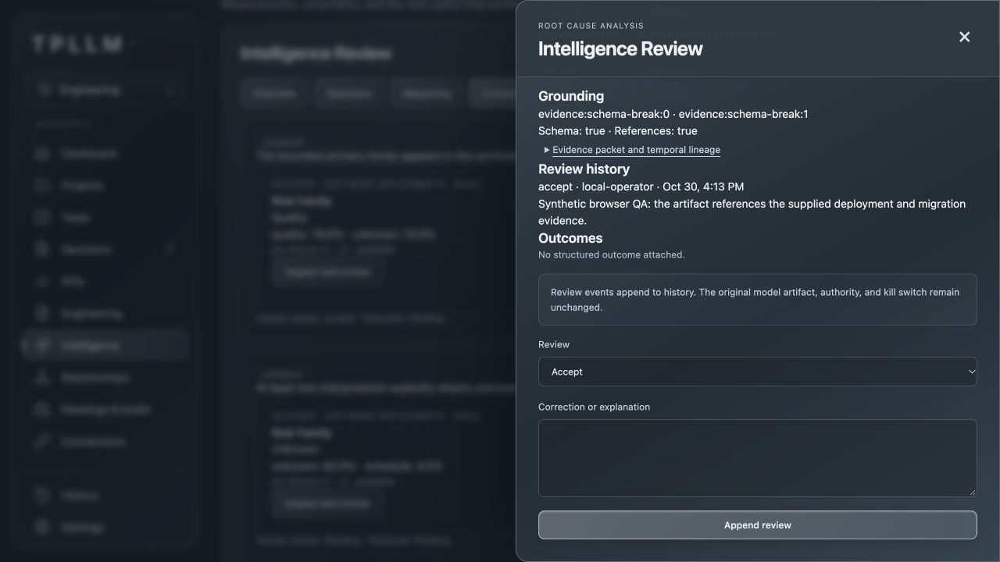

# TPLLM Phase 2 implementation and evaluation report

Run date: October 30, 2026. Existing repository; local changes only. No deployment,
commit or push was performed by this implementation. Existing work was preserved, with additive changes
at the Phase 1 integration seams. Model performance findings below are explicitly
synthetic unless stated otherwise.

## A. Updated architecture

```text
TPLLM evidence + ontology + bitemporal state
                    │
          versioned IntelligenceTask
                    │
              EvidencePacket
          ┌─────────┴──────────┐
 compact DecisionState   richer ReasoningContext
          │                    │
   existing DecisionEngine   ReasoningEngine
          │                    │
     Jev / mock          Anthropic / OpenAI / mock
          │                    │
 Noul / Choice / Score   locally validated typed artifact
          └─────────┬──────────┘
       shared journal + cohorts + evaluation
                    │
          append-only Intelligence Review

Existing operational path:
insight → validate_insight() → TPLLM policy → authority / kill switch
```

The reasoning lane produces no operational insight or executable action. Existing
insight explanations retain the original validator outcome. There is no automatic
routing, confidence-triggered escalation, ensemble or authority promotion.

## B. Intelligence task catalog

All are v1, review-only, and support the eight-cohort taxonomy. Support means an
available contract, not proven quality. The complete catalog and contracts are in
[the architecture document](intelligence-phase2.md#intelligence-task-catalog).

| Tasks | Lane | Output |
|---|---|---|
| `evidence.sufficient`, `evidence.contradictory`, `risk.present`, `review.human_recommended` | Decision | Noul |
| `trend.direction`, `risk.family`, `impact.scope` | Decision | Choice |
| `trend.materiality`, `risk.severity`, `intervention.value` | Decision | Score |
| `reasoning.root_cause_analysis` | Reasoning | Primary/alternate hypotheses, cause tags, references, unknowns |
| `reasoning.operational_summary` | Reasoning | Situation, changes, dependencies, review risks |
| `reasoning.dependency_analysis` | Reasoning | Entities, paths, bottlenecks, downstream impacts |
| `reasoning.recovery_options` | Reasoning | Options, benefits, tradeoffs, dependencies, risks, required authority |
| `reasoning.insight_explanation` | Reasoning | Existing insight reference, summary, significance, uncertainties, questions |

## C. Decision Intelligence

Phase 1 remains functional. Its provider adapter, question definitions, result
validation, batching, policy/calibration gates and journal are retained. Phase 2
wraps its traces in a shared task envelope and adds cohort/model segmentation and
attempt-count telemetry. The original ten-question tests remain part of the full
suite; Phase 2's corpus concentrates on risk present, family and severity.

No distributions are collapsed into Boolean labels or reasoning-style confidence.
Fixture Noul thresholds are evaluation boundaries only, never execution policy.

## D. Reasoning Intelligence

Five Pydantic-owned contracts have native provider schema enforcement plus local
validation. Unknown source/entity/task/ontology/insight IDs are rejected. Nested
path and recovery-option references are also checked. Missing fields, malformed
JSON, duplicate keys, wrong enums, extra action fields and numeric coercion are
rejected. There is no tool registry, tool-call request or hidden-reasoning storage.

Native Anthropic/OpenAI request shapes were verified with SDK transport doubles
and official API documentation. Installed SDKs were Anthropic 2.3.0 and OpenAI
3.40.0. No live model returned a response during this implementation.

## E. Shared evidence architecture

Both lanes use one immutable packet ID and retain its source lineage, cohort and
temporal cutoffs. Decision context stays compact; reasoning can receive bounded,
redacted excerpts and existing insight context. Current unstamped KPI projections
are excluded from historical packets; source observations remain traceable.
Later labels/outcomes append events and cannot rewrite the original context.
The product's existing KPI provenance exclusions remain in place.

## F. Evaluation model

Jev evaluation reuses Brier scores, reliability buckets, classification errors,
Choice coverage/margins and Score absolute/distribution errors. Reasoning metrics
measure structural reliability, reference validity, completion, human acceptance,
correction and missing evidence, plus task-specific reference checks.

No complex reasoning quality score is synthesized. Model-generated cause tags
and interpretation categories are claims. They are not calibrated probabilities.
The reports retain requested/resolved model identities, task hashes, cohort
versions, sample counts, failure categories and mock/live provenance.

## G. Dual-lane examples

These are authored mock responses to related synthetic evidence, not live model
comparisons. All pairs share the same packet; neither sees the other's output.

| Scenario | Decision artifact | Reasoning artifact / evaluation |
|---|---|---|
| Schema migration breaks deployments | Risk 88%; quality 78% | Schema incompatibility with deployment/migration references; compatible with added reliability effects |
| Dependency and schedule overlap | Schedule 46%, dependency 44% | Dependency delay may cause schedule pressure; compatible overlap rather than categorical error |
| Dependency delay + reduced staffing + test outage | Dependency 78% | Prose names interacting causes, but structured cause tags omit capacity and test outage; rubric flags both missing causes |
| Team capacity cut | Cost 88%, staffing 2% | Staffing/schedule interpretation; persisted conflict and incorrect bounded label |
| Recovered CI failure | Risk 12%, unknown family 82% | Transient recovered anomaly; family comparison remains ambiguous because unknown is explicit |

The deliberately inconsistent multi-causal artifact demonstrates that schema and
reference validity cannot establish semantic completeness.

## H. Efficiency

There were **zero real provider API calls**. Latency, real token usage and provider
costs are therefore unavailable. No efficiency ranking is supported.

| Workload | Mock adapter requests | Outputs | Live latency / usage / cost |
|---|---:|---:|---|
| Bounded judgments | 24 | 72, batched as 3 questions per request | Unavailable |
| Rich synthesis | 120 | 117 available, 2 rejected, 1 timeout | Unavailable |

These workloads are intentionally different. Their request counts are not a fair
cost comparison. Real runs record latency, input bytes, usage when reported,
attempts/retries and actual model IDs. No pricing assumptions are substituted for
missing cost metadata. Mock durations and usage are excluded from the UI report.

## I. Disagreements and evaluator controls

Twenty-four cross-lane comparisons persisted: **7 compatible, 3 agree, 10 ambiguous,
1 conflict, 3 unresolved**. Partially-compatible near-tie behavior is covered by
a separate test. Unknown-family ambiguity is preserved rather than called error.

The report surfaces three confidently incorrect decision results, two close
family distributions, three reasoning failures, the missing-major-cause case and
the cross-lane conflict. The failures are deliberate controls: one invented
reference, one missing required field and one timeout. Correct handling of these
fixtures is evidence that the evaluator detects these cases, not that either
vendor is accurate.

## J. Cohort-segmented fixture results

Each cohort has only three synthetic cases. Root-cause availability is not human
acceptance or correctness. Mock labels are excluded from production calibration.

| Cohort | Cases | Noul Brier | Family top-1 | Root-cause available |
|---|---:|---:|---:|---:|
| `software.deployments` | 3 | 0.0144 | 3/3 | 3/3 |
| `software.reliability` | 3 | 0.0144 | 3/3 | 3/3 |
| `project.dependencies` | 3 | 0.2856 | 1/3 | 3/3 |
| `project.schedule` | 3 | 0.0144 | 3/3 | 3/3 |
| `security.events` | 3 | 0.0144 | 3/3 | 2/3 |
| `team.capacity` | 3 | 0.0144 | 2/3 | 3/3 |
| `cost.variance` | 3 | 0.0144 | 3/3 | 2/3 |
| `general.operations` | 3 | 0.0144 | 3/3 | 2/3 |

Across this authored corpus: Noul Brier **0.04830**, Choice accuracy **21/24**,
top-2 coverage **24/24** (ties retained), multiclass Brier **0.22762**, and Score
mean absolute error **0.30**. These numbers characterize the mock fixtures only.

Of 120 reasoning invocations, 119 yielded schema-checkable responses: **118/119**
were schema-valid. Of those 118, **117/118** passed reference checks. The timeout
does not enter either denominator. Real human acceptance and correction rates
remain **unknown**. Root-cause rubrics caught the deliberate omitted causes.

## K. Tests and visible verification

Final full suite: **4,540 passed, 24 skipped** (35.74 seconds). The baseline was
**4,470 passed, 24 skipped**; Phase 2 adds 70 passing cases. The suite emitted
5,933 warnings. JavaScript syntax checks and `git diff --check` also pass.

New coverage includes task/schema fingerprints, defensive copies, source and
observation cutoffs, packet/record lineage, cohorts, SDK schemas, malformed and
refused responses, enum/reference checks, timeouts/retries, model drift segments,
SQLite restart, legacy trace loading, replay without inference, append-only
corrections, T1 structured outcomes, compatible/conflicting interpretations,
sampling, coverage gaps, immutable baseline projections and API permissions.

Browser verification on an isolated local demo confirmed overview, paired cases,
structured artifact expansion, scoped review submission, persisted review history
and the efficiency display's Unknown values. Browser console error/warning log
was empty at inspection. The review POST returned 200, and the refreshed detail
contained the new event alongside the unchanged original result. Desktop view was
tested; separate mobile/device layout testing was not performed.



## L. Authority proof

Neither inference package imports authority or tool-execution capabilities.
Providers receive schemas and bounded evidence only. Their responses cannot
provide tool calls or mutate the task/schema. New journal events are diagnostic
runtime-audit events, not organizational decisions or grants.

Tests compare coordination, recommendations, action payloads, delegations,
eligibility and receipts before and after shadow inference. They remain equal.
Injected response fields for sending messages, calendar/Jira modification, code
merge, deletion, permission changes and disabling the kill switch are rejected.
Existing execution remains held when coordination is paused. A waiting reasoning
provider does not hold the workspace lock or block deterministic derivation.
An existing insight rejected by `validate_insight()` stays rejected when included
as explanation context.

## M. Live-provider status

| Source | Status |
|---|---|
| Mock decision adapter | Executed; authored distributions |
| Mock reasoning adapter | Executed; authored artifacts and injected failures |
| Fixture references | Executed; synthetic semantic/reference expectations |
| Real Jev | Not executed: credentials/enablement unavailable |
| Real reasoning provider | Not executed: provider/model/credentials unavailable |
| Real human quality labels | None; browser review was an isolated fixture event |

The live smoke preflight recorded **8 eligible tasks, 0 executed, 8 skipped**.
Ready-to-run commands are in the [runbook](../evals/intelligence/README.md).
Machine-readable [mock results](../evals/intelligence/results.mock.json) and
[live availability](../evals/intelligence/availability.live.json) preserve the
evidence boundary. The compact example is not a journal backup; the full runner
exports the journal when `--compact` is omitted.

## N. Remaining limitations

- Three synthetic cases per cohort are insufficient for calibration, promotion or routing.
- Balanced fixture counts do not represent real cohort prevalence or imbalance.
- No live provider latency, usage, cost, refusal behavior or deployment compatibility was measured.
- Model aliases can drift; resolved IDs are retained but providers may still return aliases.
- Root-cause tag rubrics are finite and subjective; other reasoning tasks need richer human semantic rubrics.
- Reference validity cannot establish entailment, truthful source claims or complete reasoning.
- Task definitions and primary-family labels can be ambiguous in multi-causal cases.
- Product contexts without trusted cohort mappings use `general.operations`.
- Unstamped historical projections are omitted; historical completeness is not fabricated.
- Background jobs are bounded and in-process. Completed history is durable; pending jobs are rescheduled on a later collection pass.
- Deployments that disable background collection need explicit evaluation scheduling; no new hosted scheduling stack was introduced.
- CALIBRATED / VALIDATED_FOR_REVIEW promotion and automatic routing remain outside this change.

## O. Phase 3 recommendation

Do not implement Jev-first escalation or historical-best-provider routing based
on these results. Continue explicit task-specific selection, deterministic rules
and human review while collecting independent live outcomes. A bounded judgment
can be evaluated with Jev; rich synthesis needs its own artifact contract and
rubric. The multi-causal and conflict controls justify retaining both lanes, but
do not establish a measured provider advantage.

Before choosing a routing policy, collect cohort-balanced live samples with
pinned model versions, comparable bounded workloads, observed request costs,
independent reference labels, and reviewer time/correction outcomes against the
existing deterministic TPLLM baseline. Preserve failures, regressions and unknowns.
Phase 3 was not implemented.
